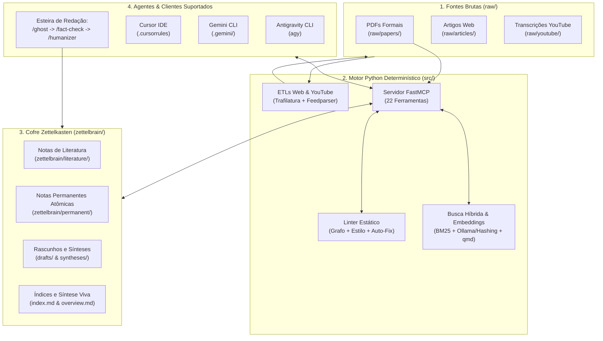

# ZettelBrain

[](https://www.python.org/)
[](https://github.com/astral-sh/uv)
[-6f42c1)](https://modelcontextprotocol.io/)
[](https://obsidian.md/)
[](zettelbrain/index.md)
[](tests/)
[](https://github.com/astral-sh/ruff)
[](LICENSE)

**ZettelBrain** é um sistema de Gestão de Conhecimento Pessoal (PKM) e Segundo Cérebro de alta fidelidade que une a metodologia **Zettelkasten** a agentes autônomos de Inteligência Artificial e a um **motor determinístico local em Python** via [Model Context Protocol (FastMCP)](https://modelcontextprotocol.io/).

O projeto resolve os problemas crônicos de bases de conhecimento geradas por IA (alucinações factuais, textos genéricos, notas superficiais com listas de marcadores, quebra de referências e perda de contexto) através de uma arquitetura dissertativa atômica estrita, esteira editorial automatizada (`/ghost` → `/fact-check` → `/humanizer`) e ferramentas de infraestrutura que garantem reprodutibilidade e integridade estrutural.

---

## Principais Pilares do Sistema

1. **Cofre Zettelkasten em Markdown (`zettelbrain/`)**:
   - Estrutura pura compatível nativamente com o [Obsidian](https://obsidian.md/).
   - Notas atômicas em **arquitetura dissertativa contínua** com a Técnica Feynman.
   - Proibição absoluta de marcadores de lista (*bullet points*) e travessões explicativos no corpo das notas conceituais.
   - Títulos H1 obrigatórios e rastreabilidade total de fontes com referências ABNT e wikilinks `[[slug]]`.
2. **Esteira Editorial e Governança de Conteúdo (`skills/`)**:
   - Catálogo canônico de **15 skills** para agentes de IA (sessão, ingestão, pesquisa, redação e manutenção).
   - Validação adversarial de fatos e premissas lógicas (`/fact-check`) com matriz de severidade (S1–S6) e *auto-fix* de dados objetivos.
   - Desintoxicação de vícios de escrita de LLM (`/humanizer`) com 8 testes de auto-auditoria estrita em Português do Brasil (PT-BR).
3. **Motor Python & Servidor FastMCP (`src/`)**:
   - Servidor MCP local com **22 ferramentas** para agentes executarem buscas, leituras e validações.
   - Busca híbrida combinando o motor externo `qmd`, BM25 léxico local e embeddings semânticos (via Hashing determinístico offline ou Ollama local).
   - Cache de leitura PageIndex para PDFs densos em `raw/papers/` ancorado no hash canônico SHA-256 do binário completo (`document_id`).
   - Linter determinístico de grafo e estilo (`zettelbrain-lint`), aplicando correções automáticas de nomes de notas e normalização de vínculos.
   - Pipelines automatizados de extração e limpeza (ETLs) para artigos da web e canais do YouTube.

---

## Arquitetura em Alto Nível



---

## Catálogo de Skills dos Agentes

As 15 skills residem na pasta canônica `skills/` e são orquestradas pelos agentes durante o ciclo de trabalho:

| Categoria | Skill | Gatilho | Finalidade |
| --- | --- | --- | --- |
| **Sessão** | `/start` | Início de trabalho | Restaura contexto de `.state/hot.md`, `.state/log.md` e `overview.md`. |
| | `/close` | Fim de trabalho | Consolida decisões, salva rascunhos e atualiza `.state/hot.md` e `log.md`. |
| **Ingestão** | `/paper` | Documentos em `raw/papers/` | Ingestão de PDFs com hash SHA-256 canônico, PageIndex e citação ABNT. |
| | `/paper-intro` | Documentos em `raw/papers/` | Triagem rápida de resumo e introdução antes da leitura profunda. |
| | `/article` | Arquivos em `raw/articles/` | Processa artigos web com avaliação de procedência e citação recuperável. |
| | `/youtube` | Arquivos em `raw/youtube/` | Processa transcrições do YouTube, tratando oralidade e checando fontes. |
| **Recuperação** | `/recall` | Mineração de contexto | Busca híbrida na base para evitar duplicatas e enriquecer notas atômicas. |
| | `/trace` | Evolução teórica | Rastreia a evolução cronológica e causal de um conceito no cofre. |
| | `/bridge` | Conexões conceituais | Cruza notas semanticamente distantes para gerar novas hipóteses. |
| | `/research-deep`| Lacunas do cofre | Pesquisa falhas conceituais e busca evidências em bases científicas. |
| **Produção** | `/ghost` | Redação acadêmica | Redige rascunhos densos com plano de voo interativo aprovado pelo usuário. |
| | `/fact-check` | Auditoria de fatos | Revisor adversarial contra alucinações com matriz S1–S6 e *auto-fix*. |
| | `/humanizer` | Polimento em PT-BR | Filtro anti-vícios de LLM, sem travessões, burstiness e teto de 4 frases. |
| | `/visual` | Modelagem visual | Gera diagramas conceituais Mermaid e slides de apresentação Marp. |
| **Manutenção** | `/lint` | Auditoria geral | Executa o linter do cofre, aplica correções e regenera `overview.md`. |

---

## Início Rápido (Quickstart)

### 1. Pré-requisitos
- Python `>=3.12`
- Gerenciador [Astral uv](https://github.com/astral-sh/uv)
- *(Opcional)* [Ollama](https://ollama.ai/) com modelo `nomic-embed-text`
- *(Opcional)* Utilitário de terminal `qmd`

### 2. Configuração do Ambiente

```powershell
# 1. Clone o repositório
git clone https://github.com/alexcamargos/llm_zettelkasten.git
cd llm_zettelkasten

# 2. Sincronize as dependências e o ambiente virtual
uv sync

# 3. Crie os diretórios de trabalho locais (ignorados pelo Git)
uv run install bootstrap

# 4. Configure as variáveis de ambiente
Copy-Item .env.example .env

# 5. Valide a integridade do servidor FastMCP
uv run python src/mcp/server.py --health-json
```

### 3. Integração com Clientes de IA

O ZettelBrain inclui geradores automatizados de configuração para os principais clientes:

```powershell
# Para Antigravity CLI (agy) - Recomendado:
uv run install antigravity  # ou: uv run install agy

# Para Cursor IDE:
uv run install cursor

# Para Gemini CLI legado:
uv run install gemini

# Para desinstalar todas as configurações de clientes:
uv run install clean
```

> **Como funciona o Antigravity (`agy`)**: O comando gera `.agents/skills/<name>/SKILL.md` com YAML frontmatter e cria `mcp_config.json`, permitindo autocompletar e acionar nativamente slash commands (como `/start`, `/recall`, `/ghost`).
>
> **Como funciona o Cursor**: O comando cria `.cursor/mcp.json` e compila as regras mestras de [ZETTELBRAIN.md](ZETTELBRAIN.md) e todas as [skills/](skills/) em um único arquivo `.cursorrules`.

---

## Comandos de Uso Comum (CLI)

O projeto expõe atalhos diretos configurados no `pyproject.toml`:

| Objetivo | Comando Principal | Alias Curto |
| --- | --- | --- |
| Iniciar o servidor FastMCP via stdio | `uv run zettelbrain-mcp` | `uv run zb-mcp` |
| Validar saúde do MCP sem transporte stdio | `uv run python src/mcp/server.py --health-json` | — |
| Rodar o linter do cofre (com auto-correção) | `uv run zettelbrain-lint` | `uv run zb-lint` |
| Rodar linter em modo somente leitura | `uv run zettelbrain-lint --no-fix` | `uv run zb-lint --no-fix` |
| Exportar relatório do linter em JSON | `uv run zettelbrain-lint --json` | `uv run zb-lint --json` |
| Baixar artigo web limpo para `raw/articles/`| `uv run zettelbrain-article-etl --url "<URL>"` | `uv run zb-article-etl --url "<URL>"` |
| Ingerir novas transcrições do YouTube | `uv run zettelbrain-youtube-etl --limit 5` | `uv run zb-youtube-etl --limit 5` |
| Simular ingestão YouTube sem gravar arquivos | `uv run zettelbrain-youtube-etl --dry-run` | `uv run zb-youtube-etl --dry-run` |
| Executar suíte completa de testes (131 testes)| `uv run pytest` | — |
| Executar análise estática de código | `uv run ruff check` | — |

---

## Estrutura do Projeto

```text
.
|-- .agents/                    # Configurações geradas para Antigravity CLI (agy)
|-- .cursor/                    # Configurações geradas para Cursor IDE
|-- .gemini/                    # Configurações geradas para Gemini CLI
|-- .pageindex/                 # Caches locais de documentos PDF (<document_id>/)
|-- .state/                     # Estado operacional da base
|   |-- hot.md                  # Contexto imediato da sessão em andamento
|   |-- log.md                  # Diário operacional das skills
|   |-- embeddings_index.json   # Cache do índice semântico vetorial (ignorado)
|   `-- historico_ingestao.txt  # Histórico de vídeos do YouTube processados (ignorado)
|-- docs/                       # Documentação técnica e guias de suporte
|   |-- arquitetura.md          # Arquitetura detalhada do sistema e guia do mantenedor
|   |-- configuracao.md         # Manual de configuração, variáveis e comandos CLI
|   |-- manual-funcionalidades-agente.md # Catálogo operacional detalhado das 15 skills
|   `-- mcp-tools.md            # Especificação técnica das 22 ferramentas MCP
|-- logs/                       # Logs estruturados gerados pelo motor Python
|-- raw/                        # Fontes brutas de entrada (somente leitura pelo agente)
|   |-- articles/               # Artigos web extraídos via trafilatura
|   |-- papers/                 # PDFs acadêmicos e relatórios formais
|   |-- youtube/                # Transcrições brutas de vídeos
|   `-- assets/                 # Imagens e anexos originais
|-- skills/                     # Catálogo canônico das 15 skills operacionais
|-- src/                        # Motor determinístico Python
|   |-- config.py               # Configurações Pydantic e resolução de caminhos
|   |-- logger.py               # Loguru estruturado e decorador de rastreabilidade
|   |-- setup.py                # Instalador de ambientes e gerador de configurações
|   |-- utils.py                # Utilitários de slugificação determinística
|   |-- zettelbrain_lint.py     # Linter estático do grafo, regras de estilo e auto-fix
|   |-- zettelbrain_mcp.py      # Entry point alternativo de execução do FastMCP
|   |-- ingestion/              # Módulos de extração de dados
|   |   |-- article_etl.py      # ETL de artigos web (trafilatura)
|   |   `-- youtube_etl.py      # ETL de canais do YouTube (feedparser + transcripts)
|   `-- mcp/                    # Servidor e ferramentas FastMCP
|       |-- server.py           # Definição e registro das 22 ferramentas MCP
|       |-- tools_command.py    # Utilitários seguros de subprocessos
|       |-- tools_embeddings.py # Motor de busca vetorial (Hashing / Ollama)
|       |-- tools_file.py       # Sandboxing de leitura e escrita no cofre
|       |-- tools_pdf.py        # Hashing SHA-256 canônico e cache PageIndex
|       `-- tools_search.py     # Algoritmo BM25 léxico e integração qmd
|-- tests/                      # Suíte de testes com pytest e pytest-mock (131 testes)
|-- zettelbrain/                # O cofre de notas em Markdown (Obsidian)
|   |-- drafts/                 # Rascunhos acadêmicos e relatórios de pesquisa
|   |-- literature/             # Notas de literatura com citação ABNT
|   |-- permanent/              # Notas permanentes atômicas conceituais
|   |-- presentations/          # Apresentações em slides Marp
|   |-- syntheses/              # Sínteses conceituais, rastreios e relatórios
|   |-- visual/                 # Diagramas conceituais Mermaid
|   |-- index.md                # Índice temático principal do cofre
|   `-- overview.md             # Síntese viva do estado do cofre
|-- pyproject.toml              # Metadados do projeto, dependências uv e scripts
|-- uv.lock                     # Lockfile determinístico do Astral uv
`-- ZETTELBRAIN.md              # Schema operacional mestre e diretrizes inegociáveis
```

---

## Guia do Mantenedor e Padrões de Engenharia

Para desenvolvedores e mantenedores que forem evoluir a base de código do ZettelBrain:

1. **Dependências e Ambientes**:
   - Utilize sempre o `uv` (`uv add`, `uv sync`). Nunca utilize comandos `pip` diretos.
2. **Padrões de Código Python**:
   - Estrita conformidade com a **PEP 8** e recursos modernos do Python 3.12+.
   - **Google-Style Docstrings** obrigatórias em todos os módulos, classes, métodos e funções, detalhando seções `Args:`, `Returns:` e `Raises:`.
3. **Padrões de Testes**:
   - Utilização exclusiva do **`pytest`** e **`pytest-mock`** (com a fixture `mocker`).
   - É terminantemente proibido o uso de `unittest`, `unittest.TestCase` ou `unittest.mock`.
   - Todos os testes devem ser baseados em funções e executados com `uv run pytest`.
4. **Adicionando Novas Ferramentas ao Servidor MCP**:
   - Implemente a lógica funcional em `src/mcp/tools_*.py`.
   - Registre a ferramenta decorada em `src/mcp/server.py` utilizando `await anyio.to_thread.run_sync(...)` para chamadas bloqueantes de I/O.
   - Atualize a documentação técnica em [docs/mcp-tools.md](docs/mcp-tools.md).
5. **Adicionando Regras ao Linter**:
   - Integre regras estáticas à classe `ZettelLinter` em `src/zettelbrain_lint.py`.
   - Escreva testes de validação correspondentes em `tests/test_zettelbrain_lint.py`.

---

## Documentação Técnica Aprofundada

Para documentação especializada, consulte os manuais em [docs/](docs/):

* [Arquitetura e Engenharia do Sistema](docs/arquitetura.md): Detalhamento do motor Python, grafo de dados e guia de extensão.
* [Guia de Configuração e Operação](docs/configuracao.md): Tabela exaustiva de variáveis `.env`, bootstrap e rotinas de desenvolvimento.
* [Manual de Funcionalidades e Skills](docs/manual-funcionalidades-agente.md): Catálogo detalhado das 15 skills, esteira editorial e convenções de log.
* [Especificação das Ferramentas MCP](docs/mcp-tools.md): Contratos de parâmetros e retornos das 22 ferramentas FastMCP.
* [Schema Operacional ZettelBrain](ZETTELBRAIN.md): Diretrizes inegociáveis de estilo, escrita e segurança do cofre.

---

## Licença

Distribuído sob a licença MIT. Consulte o arquivo [LICENSE](LICENSE) para mais detalhes.
