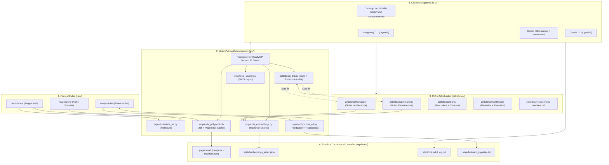
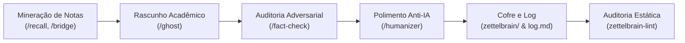

# Arquitetura e Estrutura do Sistema

## Visão Geral e Filosofia Arquitetural

O **ZettelBrain** é um sistema de Gestão do Conhecimento Pessoal (PKM) e Segundo Cérebro projetado para operação simbiótica entre humanos e agentes de Inteligência Artificial. O projeto combina três camadas complementares:

1. **O Cofre de Conhecimento (`zettelbrain/`)**: Uma rede em formato Markdown puro, compatível com o [Obsidian](https://obsidian.md/), regida pelos princípios metodológicos do Zettelkasten em arquitetura dissertativa atômica (prosa contínua, técnica Feynman, zero marcadores de lista no corpo das notas, títulos H1 obrigatórios e validação factual estrita).
2. **O Catálogo de Skills Operacionais (`skills/`)**: Instruções comportamentais padronizadas que guiam agentes de IA em ciclos de sessão, ingestão, recuperação contextual, redação acadêmica, auditoria adversarial e governança.
3. **O Motor Python Local (`src/`)**: Uma suíte determinística de alta performance que executa tarefas que **não devem** depender de heurística ou leitura livre de modelos de linguagem: cálculo canônico de hashes SHA-256 de PDFs, análise estática de integridade de grafos (linter), busca híbrida (BM25 + vetorial local/Ollama + `qmd`), extração de conteúdo web/vídeo (ETLs) e exposição de 22 ferramentas locais via [Model Context Protocol (FastMCP)](https://modelcontextprotocol.io/).

Essa separação garante que o cofre de notas permaneça totalmente independente de softwares proprietários ou bancos de dados opacos, enquanto o motor em código assegura rigor analítico e reprodutibilidade científica.

---

## Diagrama da Arquitetura do Sistema



---

## Estrutura do Repositório

```text
.
|-- .agents/                    # Configurações geradas para Antigravity CLI (agy)
|-- .cursor/                    # Configurações geradas para Cursor IDE (mcp.json)
|-- .gemini/                    # Configurações geradas para Gemini CLI
|-- .pageindex/                 # Caches locais de documentos PDF (<document_id>/)
|-- .state/                     # Estado operacional versionado e caches locais
|   |-- hot.md                  # Memória contextual da sessão em andamento
|   |-- log.md                  # Diário operacional estruturado de operações
|   |-- embeddings_index.json   # Cache do índice vetorial (ignorado pelo Git)
|   `-- historico_ingestao.txt  # Controle de vídeos processados (ignorado)
|-- docs/                       # Documentação técnica e manuais de operação
|   |-- arquitetura.md          # Esta documentação de engenharia e arquitetura
|   |-- configuracao.md         # Guia de configuração, ambiente e variáveis
|   |-- manual-funcionalidades-agente.md # Catálogo detalhado das 15 skills
|   `-- mcp-tools.md            # Especificação das 22 ferramentas MCP
|-- logs/                       # Logs de execução rotacionados pelo loguru
|-- raw/                        # Fontes de entrada brutas (somente leitura pelo agente)
|   |-- articles/               # Artigos e recortes web em Markdown
|   |-- assets/                 # Imagens e anexos brutos
|   |-- papers/                 # PDFs formais e artigos acadêmicos
|   `-- youtube/                # Transcrições brutas extraídas pelo ETL
|-- skills/                     # Arquivos mestres canônicos das 15 skills
|-- src/                        # Motor Python da infraestrutura local
|   |-- config.py               # Pydantic Settings e resolução de diretórios
|   |-- logger.py               # Configuração estruturada do Loguru e decorador
|   |-- setup.py                # Gerenciador de bootstrap e instaladores de clientes
|   |-- utils.py                # Utilitários de slugificação determinística
|   |-- zettelbrain_lint.py     # Linter estático de integridade, grafo e estilo
|   |-- zettelbrain_mcp.py      # Entry point alternativo de inicialização do MCP
|   |-- ingestion/              # Módulos de extração e processamento de dados (ETL)
|   |   |-- article_etl.py      # Download e parsing de artigos web (trafilatura)
|   |   `-- youtube_etl.py      # Leitura de playlist RSS e extração de legendas
|   `-- mcp/                    # Implementação do servidor e ferramentas FastMCP
|       |-- server.py           # Definição e registro das 22 ferramentas FastMCP
|       |-- tools_command.py    # Utilitário de parsing e split seguro de comandos
|       |-- tools_embeddings.py # Índice semântico vetorial (Hashing / Ollama)
|       |-- tools_file.py       # Leitura e escrita segura no cofre (path sandbox)
|       |-- tools_pdf.py        # Hashing SHA-256 canônico e cache PageIndex
|       `-- tools_search.py     # Motor léxico BM25 e integração opcional qmd
|-- tests/                      # Suíte de testes automatizados com pytest (131 testes)
|-- zettelbrain/                # O cofre de notas em Markdown (Obsidian)
|   |-- assets/                 # Anexos visuais das notas
|   |-- drafts/                 # Rascunhos acadêmicos e relatórios de pesquisa
|   |-- literature/             # Notas de literatura (resumos e análise de fontes)
|   |-- permanent/              # Notas permanentes atômicas conceituais
|   |-- presentations/          # Apresentações em slides Marp
|   |-- syntheses/              # Sínteses conceituais, rastreios e relatórios
|   |-- visual/                 # Diagramas conceituais Mermaid
|   |-- index.md                # Índice temático principal do cofre
|   `-- overview.md             # Síntese viva de alto nível da base
|-- pyproject.toml              # Configuração do projeto, dependências uv e scripts CLI
|-- README.md                   # Apresentação do projeto e guia de introdução
|-- uv.lock                     # Lockfile do Astral uv para builds reproduzíveis
`-- ZETTELBRAIN.md              # Schema operacional mestre e diretrizes inegociáveis
```

---

## Detalhamento dos Módulos Python

### 1. `src/config.py` (Governança de Configuração)
- Baseado em `pydantic-settings` e `pydantic`.
- Lê variáveis do arquivo `.env` com validação estrita de tipos e defaults seguros.
- Resolve caminhos absolutos baseados na raiz do repositório (`OBSIDIAN_VAULT_PATH`).
- Centraliza limites operacionais: níveis e rotação de log, timeouts de chamadas externas (`qmd`, PageIndex, Ollama), limites de busca léxica e políticas de repetição de download de artigos.

### 2. `src/logger.py` (Observabilidade e Rastreabilidade)
- Configura o `loguru` para escrita concorrente e rotação de arquivos de log (`logs/zettelbrain.log`).
- Fornece fallback automático para a biblioteca padrão `logging` em caso de restrições de ambiente.
- Provê o decorador `@log_skill_execution`, que registra automaticamente o início, término, argumentos e exceções de ferramentas MCP e rotinas operacionais.

### 3. `src/setup.py` (Automação de Ambiente e Clientes)
- Executado via `uv run install [comando]`.
- **`bootstrap` / `local`**: Cria a malha de diretórios de trabalho ignorados pelo Git (`raw/`, `zettelbrain/`, `logs/`, `.state/`, `.pageindex/`).
- **`antigravity` / `agy`**: Sincroniza todas as 15 skills de `skills/*.md` para `.agents/skills/<name>/SKILL.md`, formatando o cabeçalho YAML frontmatter com `name` e `description` para habilitar autocompletar e slash commands nativos no Antigravity CLI. Cria `mcp_config.json`.
- **`gemini`**: Sincroniza tanto `.agents/` quanto o diretório legado `.gemini/` (`settings.json` e `.gemini/skills/`).
- **`cursor`**: Gera `.cursor/mcp.json` e compila `ZETTELBRAIN.md` com todo o acervo de `skills/` em um arquivo consolidado `.cursorrules`.
- **`clean` / `uninstall`**: Remove configurações específicas de clientes, restaurando a árvore do repositório a um estado limpo.

### 4. `src/zettelbrain_lint.py` (Linter Estático do Grafo e Estilo)
Audita a base semântica sem invocar modelos de linguagem. O linter implementa:
- **Correções Automáticas Determinísticas (Auto-Fix)**:
  - Renomeação de notas de literatura com fontes web informais para a convenção canônica (`article-[titulo].md` e `youtube-[autor]-[titulo].md`), regravando automaticamente todos os wikilinks que apontavam para o nome antigo.
  - Normalização do campo `sources:` em notas permanentes para o formato Obsidian de lista de strings citadas (`sources:\n  - "[[nota]]"`).
- **Auditoria Estrutural de Integridade**:
  - `dead_link`: Wikilinks apontando para arquivos inexistentes no cofre (Erro crítico, status 1).
  - `orphan_note`: Notas sem qualquer link de entrada no grafo conceitual (Aviso).
  - `weak_connection`: Notas permanentes ativas com menos de 2 links conceituais em seu corpo (Aviso).
  - `deprecated_target`: Menções ativas a notas que foram marcadas como depreciadas no frontmatter (Aviso).
- **Auditoria de Estilo e Anti-Vício de LLM**:
  - `missing_h1_title`: Falta de título de primeiro nível (`# Título`) logo após o frontmatter.
  - `style_bullet_points`: Presença indevida de marcadores de lista no corpo de notas conceituais.
  - `style_em_dash`: Presença de travessões (`—` ou `–`) no corpo do texto.
  - `style_ai_cliche`: Detecção de rótulos artificiais de seção (`Introdução:`, `Conclusão:`) e clichês de IA (`ademais`, `outrossim`, `destarte`, `no cenário contemporâneo`, etc.).
- **Mineração de Padrões Emergentes**:
  - Identifica termos em negrito (`**termo**`) presentes em 3 ou mais notas distintas que ainda não possuem nota atômica correspondente, sugerindo novos nós para o grafo.

### 5. `src/mcp/` (Camada de Exposição FastMCP)
- **`server.py`**: Constrói a instância `FastMCP("ZettelBrain")` registrando as 22 ferramentas. Todas as operações com I/O síncrono são despachadas para worker threads assíncronas via `anyio.to_thread.run_sync`.
- **`tools_search.py`**: Motor de busca léxica com algoritmo BM25 customizado, segmentação de tokens, cálculo de score e integração com a ferramenta externa `qmd`.
- **`tools_embeddings.py`**: Geração vetorial utilizando o provider configurado (`hashing` determinístico offline com 256 dimensões ou `ollama`). Calcula similaridades de cosseno para `semantic_search_zettelbrain`, `suggest_zettelbrain_links` e `get_semantic_bridge`.
- **`tools_pdf.py`**: Manipulação determinística de PDFs em `raw/papers/`. Resolve o SHA-256 do binário completo, inspeciona e grava caches em `.pageindex/<document_id>/`, e oferece estimativas de páginas, tokens e custos.
- **`tools_file.py`**: Operações de leitura e escrita restritas estritamente à pasta `zettelbrain/`, com sanitização contra *directory traversal*.

### 6. `src/ingestion/` (ETLs de Dados Brutos)
- **`article_etl.py`**: Executado via `zb-article-etl --url "<URL>"`. Extrai o conteúdo principal sem poluição publicitária utilizando `trafilatura`. Grava o Markdown resultante em `raw/articles/` com frontmatter contendo metadados de procedência e registra falhas de rede em `logs/article_access_errors.jsonl`.
- **`youtube_etl.py`**: Executado via `zb-youtube-etl --limit N`. Consome o feed RSS da playlist configurada em `YOUTUBE_PLAYLIST_ID`, extrai legendas através da biblioteca `youtube-transcript-api` e armazena as transcrições em `raw/youtube/`. O histórico de vídeos ingeridos é mantido em `.state/historico_ingestao.txt`.

---

## Modelo de Dados do Cofre

O cofre é organizado por categorias semânticas com contratos de metadados específicos:

```yaml
# 1. Nota de Literatura (zettelbrain/literature/nome-da-nota.md)
---
type: literature
source_kind: paper | web_article | youtube_transcript
id: 202610181530
title: "Título Analítico da Obra"
authors: [Autor Principal, Segundo Autor]
year: 2026
source_file: raw/papers/documento.pdf
abnt_reference: "Referência no padrão ABNT"
confidence: high | medium | low   # Obrigatório para web e youtube
---

# Título da Nota em H1

Prosa contínua e dissertativa explicando a tese central...
```

```yaml
# 2. Nota Permanente Atômica (zettelbrain/permanent/conceito-chave.md)
---
type: permanent
id: 202610181545
tags: [economia, inteligencia-artificial, risco]
sources:
  - "[[nome-da-nota-de-literatura]]"
confidence: high
deprecated: false
---

# Conceito Central da Nota

Desenvolvimento dissertativo em prosa contínua com técnica Feynman.
Conexão lógica com outras notas do cofre como [[outro-conceito-relacionado]].
```

### Regras de Ouro do Cofre
1. **Linguagem**: Estritamente em Português do Brasil (PT-BR).
2. **Formato**: Prosa dissertativa contínua. É terminantemente proibido o uso de marcadores (bullet points) no corpo das notas (listas com hífen são restritas unicamente ao `zettelbrain/index.md`).
3. **Links**: Exclusivamente no formato Obsidian `[[slug-da-nota]]`. É proibido usar links markdown tradicionais `[texto](caminho.md)` para referências internas.
4. **Imutabilidade de Deleoção**: Notas ultrapassadas nunca são apagadas do cofre; em vez disso, são marcadas com `deprecated: true` e `superseded_by: [[nova-nota]]`.

---

## Esteira de Produção Textual e Governança

Para garantir que textos longos e sínteses acadêmicas geradas pelo sistema não apresentem alucinações, erros materiais ou clichês vazios de modelos de linguagem, o ZettelBrain adota um pipeline sequencial e mandatório:



1. **Rascunho Acadêmico (`/ghost`)**: Constrói o texto dissertativo com base em notas reais do cofre após aprovação de um plano de voo interativo.
2. **Auditoria Adversarial (`/fact-check`)**: Atua como revisor hostil. Classifica afirmações em uma matriz de severidade (S1 a S6). Realiza *auto-fix* imediato de erros materiais objetivos (números, datas, citações erradas) e submete inconsistências lógicas conceituais à aprovação humana, sem alterar a tese central.
3. **Polimento Anti-Vício de LLM (`/humanizer`)**: Aplica 8 testes de auto-auditoria estrita em PT-BR. Elimina falsos contrastes (*"Não é X, é Y"*), gerúndios vazios de cauda, travessões explicativos (`—`), clichês engessados (*"outrossim"*, *"no cenário contemporâneo"*) e impõe um teto estrito de 4 frases por parágrafo com ritmo variado (*burstiness*).
4. **Governança Estática (`/lint` / `zettelbrain-lint`)**: Audita a integridade do grafo, links mortos, notas órfãs e conformidade de estilo de todas as notas do cofre, atualizando o índice vivo `zettelbrain/overview.md`.

---

## Guia de Extensão para Mantenedores

### Adicionando uma Nova Ferramenta MCP
1. Implemente a lógica funcional correspondente em um dos módulos de suporte (`src/mcp/tools_*.py`).
2. Abra `src/mcp/server.py`.
3. Escreva a função decorada com `@log_skill_execution`.
4. Se a operação envolver chamadas de I/O bloqueante (disco, subprocessos ou rede), encapsule com `await anyio.to_thread.run_sync(...)`.
5. Registre a ferramenta na função `build_server()` via `server.tool()(nome_da_funcao)`.
6. Crie os testes unitários funcionais correspondentes em `tests/` utilizando fixtures do `pytest` e `pytest-mock`.
7. Atualize a tabela e os contratos em `docs/mcp-tools.md`.

### Adicionando uma Nova Regra ao Linter
1. Abra `src/zettelbrain_lint.py`.
2. Adicione os padrões regex ou regras analíticas necessárias na classe `ZettelLinter`.
3. Se a regra for de estilo de nota conceitual, integre-a ao método `_validate_note_style`.
4. Se a regra permitir correção determinística confiável, implemente o método correspondente `apply_*_fixes` e invoque-o em `run_linter`.
5. Escreva casos de teste dedicados em `tests/test_zettelbrain_lint.py`.
6. Valide a suíte completa executando:
   ```powershell
   uv run pytest
   ```
