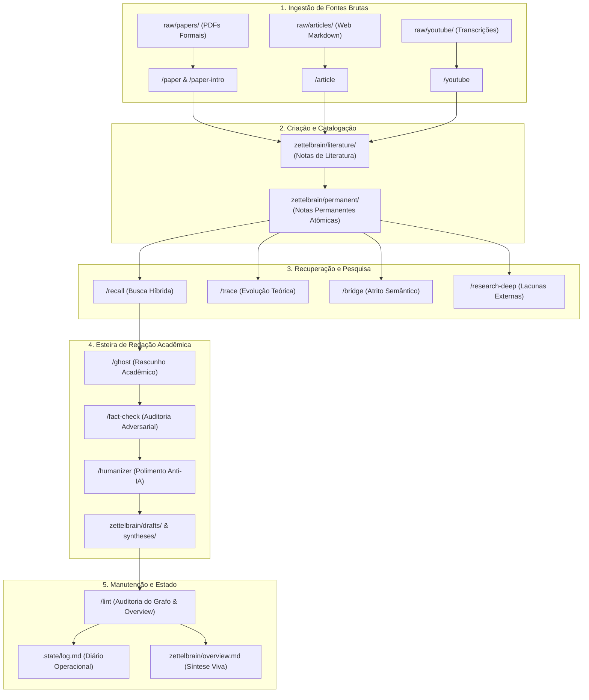

# Manual de Funcionalidades e Catálogo de Skills

Este manual descreve o comportamento operacional dos agentes de inteligência artificial que atuam no **ZettelBrain**, detalhando os contratos de execução das **15 skills** padronizadas e sua integração com as ferramentas do motor Python local.

---

## 1. Princípios Operacionais e Diretrizes Inegociáveis

Todo agente que opera sobre o cofre `zettelbrain/` deve obedecer estritamente aos princípios definidos em [ZETTELBRAIN.md](../ZETTELBRAIN.md):

* **Idioma Obrigatório**: Todas as notas, rascunhos, sínteses, apresentações e logs devem ser redigidos exclusivamente em **Português do Brasil (PT-BR)**.
* **Paradigma Metodológico**: Notas atômicas em **arquitetura dissertativa contínua**, aplicando a **Técnica Feynman** calibrada para um público executivo e de pós-graduação.
* **Proibição de Marcadores de Lista (Bullet Points)**: O corpo das notas (`literature/`, `permanent/`, `drafts/`, `syntheses/`) não pode conter listas com marcadores ou itens numerados. O texto deve fluir em parágrafos contínuos. O único arquivo com permissão de listas com hífen é o `zettelbrain/index.md`.
* **Título H1 Obrigatório no Corpo**: Toda nota nova deve iniciar com `# Título da Nota` logo após o fechamento do bloco YAML frontmatter.
* **Sintaxe de Links**: Exclusivamente wikilinks nativos do Obsidian: `[[nome-exato-da-nota]]`. Links Markdown `[texto](caminho.md)` são terminantemente proibidos para arquivos internos.
* **Restrições de Pontuação e Estilo**: É proibido o uso de travessões explicativos (`—` ou `–`), emojis ou rótulos artificiais de seção no início de parágrafos (`Introdução:`, `Conclusão:`).
* **Imutabilidade e Depreciação**: Arquivos nunca devem ser deletados sem solicitação explícita do usuário. Notas superadas devem receber `deprecated: true` no frontmatter e link para a nota substituta (`superseded_by: [[nova-nota]]`).

---

## 2. Diagrama do Ciclo de Vida da Informação



---

## 3. Catálogo Detalhado das 15 Skills

### Categoria A: Sessão e Continuidade Operacional

#### 1. `/start` (Briefing e Restauração de Contexto)
- **Arquivo de Regras**: [skills/start.md](../skills/start.md)
- **Objetivo**: Inicializar a sessão de trabalho restaurando a memória recente e o foco do usuário sem poluir o histórico.
- **Leituras**: `.state/hot.md`, `.state/log.md` (últimas entradas) e `zettelbrain/overview.md`.
- **Comportamento**: Sintetiza o estado atual do cofre, destaca tarefas em aberto e sugere o próximo passo prioritário.
- **Regra Especial**: Esta skill **não** grava entradas em `.state/log.md`.

#### 2. `/close` (Encerramento de Sessão e Consolidação)
- **Arquivo de Regras**: [skills/close.md](../skills/close.md)
- **Objetivo**: Encerrar o expediente de trabalho, consolidando o que foi produzido no dia em um formato facilmente recuperável na próxima sessão.
- **Escritas**: Atualiza `.state/hot.md` (prosa curta com o foco em andamento) e insere cabeçalho final de fechamento em `.state/log.md`.
- **Captura de Ideias**: Pode colher ideias discutidas durante o chat que não foram formalizadas e gravá-las como rascunhos em `zettelbrain/drafts/`.

---

### Categoria B: Ingestão de Fontes Brutas (`raw/`)

#### 3. `/paper` (Ingestão Completa de Documentos Formais)
- **Arquivo de Regras**: [skills/paper.md](../skills/paper.md)
- **Entrada**: Arquivos em `raw/papers/` (PDFs ou documentos acadêmicos densos).
- **Identificador Canônico**: Utiliza estritamente o SHA-256 do binário completo como `document_id`.
- **Aceleração**: Consulta o cache PageIndex em `.pageindex/<document_id>/` para leitura por páginas estruturadas.
- **Saídas**:
  - Nota de literatura detalhada em `zettelbrain/literature/` contendo referência ABNT completa.
  - Após validação e diálogo com o usuário, gera notas permanentes atômicas em `zettelbrain/permanent/`.
- **Ferramentas MCP**: `compute_pdf_sha256`, `resolve_pdf`, `read_pdf_cache`, `read_pdf_page`, `index_pdf_cache`, `estimate_pdf_processing`.

#### 4. `/paper-intro` (Triagem Rápida de Papers)
- **Arquivo de Regras**: [skills/paper-intro.md](../skills/paper-intro.md)
- **Entrada**: PDFs em `raw/papers/`.
- **Objetivo**: Ler e analisar exclusivamente o resumo (abstract), introdução e conclusões preliminares para triagem rápida de relevância, antes de decidir pelo processamento profundo via `/paper`.

#### 5. `/article` (Ingestão de Artigos Web Informais)
- **Arquivo de Regras**: [skills/article.md](../skills/article.md)
- **Entrada**: Arquivos Markdown em `raw/articles/` obtidos via ETL web.
- **Comportamento**: Avalia criticamente a procedência e a autoridade da fonte. Exige o campo `confidence: high | medium | low` no frontmatter YAML da nota de literatura.
- **Convenção de Nome**: O nome do arquivo gerado deve seguir o padrão `article-[titulo-do-artigo].md`.

#### 6. `/youtube` (Ingestão de Transcrições de Vídeos)
- **Arquivo de Regras**: [skills/youtube.md](../skills/youtube.md)
- **Entrada**: Arquivos Markdown em `raw/youtube/` contendo `source_kind: youtube_transcript`.
- **Comportamento**: Trata vícios de oralidade, falhas de pontuação da transcrição automática e exige averiguação contra fontes primárias.
- **Convenção de Nome**: O nome do arquivo gerado deve seguir o padrão `youtube-[autor]-[titulo-do-video].md`.

---

### Categoria C: Recuperação, Descoberta e Pesquisa

#### 7. `/recall` (Busca e Mineração de Contexto)
- **Arquivo de Regras**: [skills/recall.md](../skills/recall.md)
- **Objetivo**: Minerar o conhecimento já catalogado no cofre antes de criar novas notas, evitando duplicatas e sugerindo reconciliação de notas existentes.
- **Ferramentas MCP**: `search_zettelbrain` (busca híbrida BM25 + embeddings), `read_zettelbrain_markdown`, `suggest_zettelbrain_links`.

#### 8. `/trace` (Rastreamento Cronológico e Causal)
- **Arquivo de Regras**: [skills/trace.md](../skills/trace.md)
- **Objetivo**: Reconstituir a evolução histórica, cronológica ou conceitual de uma ideia, framework ou variável de risco através dos links do cofre.
- **Saída**: Grava sínteses densas no diretório `zettelbrain/syntheses/`.

#### 9. `/bridge` (Atrito Semântico e Conexões Inusitadas)
- **Arquivo de Regras**: [skills/bridge.md](../skills/bridge.md)
- **Objetivo**: Forçar conexões interdisciplinares entre conceitos aparentemente distantes na base para gerar hipóteses originais e insights de pesquisa.
- **Ferramenta MCP**: `get_semantic_bridge` (calcula pares com similaridade vetorial entre 0.05 e 0.40).

#### 10. `/research-deep` (Mapeamento de Lacunas e Busca Externa)
- **Arquivo de Regras**: [skills/research-deep.md](../skills/research-deep.md)
- **Objetivo**: Identificar contradições ou carências conceituais no cofre e realizar buscas aprofundadas em bases externas autoritativas.
- **Saída**: Gera relatórios preliminares de pesquisa em `zettelbrain/drafts/`. Fontes selecionadas são encaminhadas para `raw/papers/` e processadas por `/paper`.

---

### Categoria D: Produção Dissertativa e Governança de Qualidade

#### 11. `/ghost` (Redação Acadêmica e Síntese Textual)
- **Arquivo de Regras**: [skills/ghost.md](../skills/ghost.md)
- **Objetivo**: Redigir rascunhos acadêmicos e capítulos estruturados em prosa dissertativa com base exclusivamente no acervo do cofre.
- **Etapas**:
  1. *Mineração e Escopo*: Localiza notas relevantes via `search_zettelbrain`.
  2. *Plano de Voo Interativo*: Apresenta proposta de tese e esqueleto do texto ao usuário, exigindo aprovação antes de redigir.
  3. *Redação Rigorosa*: Prosa contínua, técnica Feynman, sem marcadores de lista, sem travessões e sem clichês.
  4. *Integração*: Invoca compulsoriamente a validação factual de `/fact-check` e o polimento estilístico de `/humanizer`.
- **Saída**: Grava o rascunho em `zettelbrain/drafts/rascunho-[topico].md` e indexa em `zettelbrain/index.md`.

#### 12. `/fact-check` (Auditoria Adversarial de Fatos e Lógica)
- **Arquivo de Regras**: [skills/fact-check.md](../skills/fact-check.md)
- **Objetivo**: Atuar como revisor hostil contra alucinações, números imprecisos, links mortos, premissas frágeis e citações truncadas.
- **Matriz de Severidade**:
  - `S1` (Falsidade flagrante / alucinação): *Auto-fix* cirúrgico imediato.
  - `S2` (Erro material de número, data ou métrica): *Auto-fix* cirúrgico imediato.
  - `S3` (Recorte enganoso / cherry-picking): Sinalização e confirmação com o usuário.
  - `S4` (Alegação sem fonte comprovada): Exclusão ou busca de evidência primária.
  - `S5` (Falha lógica / contradição interna): Alerta crítico ao usuário sem alterar a tese central.
  - `S6` (Imprecisão menor de redação): *Auto-fix* cirúrgico imediato.

#### 13. `/humanizer` (Filtro Anti-Vício de IA e Polimento em PT-BR)
- **Arquivo de Regras**: [skills/humanizer.md](../skills/humanizer.md)
- **Objetivo**: Editor estilístico rigoroso que elimina vícios mecânicos de modelos de linguagem, garantindo leitura natural e elegante em padrão culto.
- **Regras Mecânicas**:
  - **Teto de 4 Frases por Parágrafo**: Parágrafos visuais enxutos para alta legibilidade.
  - **Ritmo Variado (*Burstiness*)**: Alternância proposital entre frases médias explicativas e frases curtas contundentes.
  - **Proibição de Travessões (`—` e `–`)**: Substituição por vírgulas, parênteses ou quebra em dois períodos diretos.
  - **Eliminação de Vícios Estruturais**: Corte de falsos contrastes (*"Não é X, é Y"*), gerúndios de cauda (*"...garantindo maior eficácia"*) e tríades automáticas.
  - **Banimento de Clichês**: Proibição de expressões como *"outrossim"*, *"ademais"*, *"destarte"*, *"no cenário contemporâneo"*, *"mergulho profundo"*, etc.
  - **8 Testes de Auto-Auditoria**: Executados compulsoriamente antes de salvar qualquer texto dissertativo.

#### 14. `/visual` (Visualização Conceitual e Apresentações)
- **Arquivo de Regras**: [skills/visual.md](../skills/visual.md)
- **Objetivo**: Transformar modelos teóricos e grafos conceituais em diagramas visuais e apresentações.
- **Formatos Suportados**:
  - Diagramas Mermaid (`flowchart`, `graph`, `sequenceDiagram`) em `zettelbrain/visual/`.
  - Slides técnicos em formato Marp Markdown em `zettelbrain/presentations/`.

---

### Categoria E: Manutenção e Governança do Cofre

#### 15. `/lint` (Auditoria da Base e Atualização do Overview)
- **Arquivo de Regras**: [skills/lint.md](../skills/lint.md)
- **Objetivo**: Auditar a integridade de toda a base de conhecimento e registrar a saúde geral do cofre.
- **Ações**:
  1. Invoca a ferramenta MCP `lint_zettelbrain` (ou o CLI `zettelbrain-lint`) para análise estática e aplicação de auto-fixes.
  2. Identifica links mortos, notas órfãs, desconexões e problemas de estilo.
  3. **Regenera `zettelbrain/overview.md`**: Atualiza a síntese viva de alto nível da base, refletindo a contagem de notas, áreas de concentração e lacunas temáticas.
  4. Registra a operação detalhada em `.state/log.md`.

---

## 4. Convenções de Log e Estado

### Diário Operacional (`.state/log.md`)
Toda skill que realize modificações no cofre ou execute leitura profunda de notas deve registrar a operação ao término.

**Formato Canônico do Cabeçalho**:
```markdown
## [AAAA-MM-DD] /nome-exato-da-skill | Resumo conciso da operação executada
```

**Corpo Obrigatório do Registro**:
- Lista explícita de todos os caminhos relativos de arquivos **criados**.
- Lista explícita de todos os caminhos relativos de arquivos **alterados**.
- Lista de arquivos que serviram como **leitura e fundamentação** detalhada da operação.

### Memória de Sessão (`.state/hot.md`)
Mantém uma síntese em prosa contínua (sem marcadores de lista) do foco atual da pesquisa, conceitos em discussão e documentos em processamento (incluindo nome do arquivo e hash `document_id`), permitindo retomada instantânea pelo `/start`.
